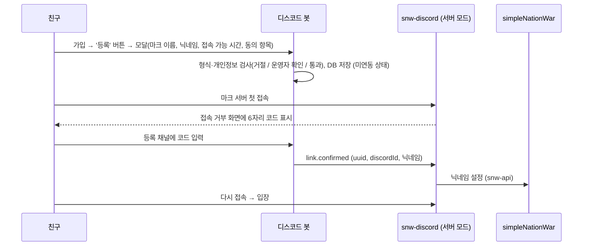

# 커스텀 닉네임

디스코드 서버에 들어오면 **반드시** 마크 커스텀 닉네임(인게임에서 마크 이름 대신 보일 이름)을 적는다. 등록은 디스코드 봇이 받고([bot.md](../discord/bot.md)), 서버에서의 표시는 simpleNationWar 가 맡는다.

## 1. 규칙

| 항목 | 규칙 |
|---|---|
| 길이 | 2 ~ 10자 |
| 문자 | 한글(완성형), 영문, 숫자, 밑줄 |
| 중복 | 불가 (대소문자 무시) |
| 다른 사람의 마크 이름과 같음 | 불가 (사칭 방지) |
| 금지어 | 운영자가 관리하는 목록 |
| 이모지·특수문자·공백 | 불가 (채팅·명령 자동완성·지도 팝업에서 깨지지 않게) |
| 변경 | 시즌 시작 전 자유, 시즌 중 1회(운영자 승인) |

## 2. 표시 위치

| 위치 | 표시 | 방법 |
|---|---|---|
| **탭 목록** | `[국가] 닉네임` | 플레이어 정보 패킷의 표시 이름 |
| **채팅 발신자** | `[국가] 닉네임: …` | 플레이어 표시 이름. 채팅 서명은 메시지 내용에만 걸리므로 이름을 바꿔도 서명이 깨지지 않는다 |
| **사망·처치 메시지** | 닉네임 | 표시 이름을 쓰는 바닐라 메시지 그대로 |
| **`/info` 카드** | `닉네임 (마크이름)` | 마크 이름은 회색 작은 글씨 |
| **국가 GUI 국민 목록** | 머리 아이콘 이름 = 닉네임, 설명 첫 줄 = 마크 이름 | |
| **웹 지도 영토 팝업** | 국민 목록을 닉네임으로 | |
| **망자 좀비 이름표** | `망자 · 닉네임` | zomApo |
| **디스코드 서버 별명** | `닉네임` | 봇이 자동 설정. 마크 이름은 다른 서비스 계정과 이어질 수 있어 디스코드에는 드러내지 않는다 |
| **디스코드 알림** | 닉네임 | 킬 피드, 망자, 거점전 결과 |
| **명령 인자** | 닉네임 또는 마크 이름 | `/info`, 운영자 명령 자동완성에 둘 다 |
| **칭호** | `학살자 닉네임` | 탭 목록·`/info` 에서 닉네임 앞 |
| **상호평가 화면** | 닉네임 (마크이름) | 평가할 사람을 헷갈리지 않게 |
| **시즌 결산·명예의 전당** | 닉네임 | |

### 머리 위 이름표

머리 위 이름은 바닐라 클라이언트에서 마크 이름 + 팀 접두사·접미사만 그릴 수 있다. 기본은 **마크 이름 + 국가 색**으로 둔다.

닉네임을 머리 위에 띄우고 싶다면, 보는 사람마다 가짜 팀 패킷을 보내 플레이어마다 접미사 ` (닉네임)` 을 붙이는 방법이 있다. 실제 팀(국가)은 서버 쪽에서 그대로 두고 클라이언트에만 개인 팀을 보여 주는 방식이라 구현이 까다롭다. 시즌 1 에서는 선택 과제로 둔다.

## 3. 개인정보 차단

닉네임 자체에 실명·학교·출생연도·연락처가 들어갈 수 있다. 가입할 때 검사기([`NicknameValidator`](../../logic/src/main/kotlin/dev/menonng/snw/logic/nickname/NicknameValidator.kt))가 세 단계로 판정한다. 규칙으로 모든 개인정보를 잡을 수는 없으므로 **가입 모달의 자기 확인 체크**와 **운영자 승인**을 함께 쓴다.

| 판정 | 조건 | 예 |
|---|---|---|
| **거절** | 숫자 4자리 이상 연속(전화번호·생년월일) | `민수0101`, `노을2009` |
| 거절 | 숫자 3개 이상 | `a1b2c3` |
| 거절 | 연락처·계정을 떠올리게 하는 낱말: naver, gmail, kakao, insta, discord, 카톡, 인스타, 디코, 전번, 번호, 연락 … (짧은 line·dm·call·mail 은 밑줄로 나뉜 조각이 정확히 같을 때만) | `insta_noeul`, `카톡하자`, `noeul_dm` |
| 거절 | 학교·학년·반: 학교, 학년, 고등, 중학, 초등, 대학, 학번, `3학년`, `2반` | `한빛고등`, `3학년2반` |
| **운영자 확인** | 흔한 성씨로 시작하는 한글 3자, 복성 + 2자 | `김민수`, `박서연`, `남궁민수` |
| 운영자 확인 | 로마자 성 + 이름 꼴 | `kim_minsu`, `minsukim`, `parkjiwoo` |
| 운영자 확인 | 출생연도처럼 보이는 두 자리 숫자(00~15, 80~99) | `노을08` |
| 운영자 확인 | 한글 2~4자 + 초·중·고로 끝나는 학교명 꼴 | `한빛고` |
| 운영자 확인 | 지역 이름(서울, 부산 …)·동 번지 꼴 | `부산사람`, `역삼1동` |
| 통과 | 그 밖 | `노을빛`, `좀비사냥꾼`, `하루2`, `Ghost_7` |

- '운영자 확인'은 거절이 아니다. 봇이 운영진 채널에 이유와 함께 올리고, 승인 버튼을 누르면 등록된다. 오탐(예: `고양이`)이 나지 않도록 성씨 목록은 흔한 성 위주로 좁혔고, 성씨로 시작하는 흔한 낱말은 예외 목록에 두었다.
- 이미 등록된 닉네임이라도 생존일지는 쓸 때마다 다시 검사해서, 거절 판정이면 익명으로 쓴다([diary.md](../discord/diary.md)).
- 머리 위 이름표·탭 목록에 보이는 마크 이름은 바닐라 클라이언트 구조상 감출 수 없다. 대신 디스코드·생존일지·지도에는 마크 이름을 쓰지 않는다.

## 4. 다른 용도 (추천)

| 용도 | 설명 |
|---|---|
| 상호평가 | 평가 대상 표시 이름 |
| 팀 편성 결과 발표 | 디스코드 임베드 |
| 전서구(couriersRoost) | 발신자·수신자 이름. couriersRoost 가 `getName()` 을 쓰면 표시 이름을 쓰도록 맞춘다 |
| 귓속말 대상 | `/msg` 자동완성에 닉네임 추가(바닐라 명령 확장) |
| 표지판·책 서명 | 그대로 두되, `/info` 에서 마크 이름 ↔ 닉네임 대조 가능 |
| 시즌 엔딩 크레딧 | 최후의 호드 종료 후 타이틀로 참여자 닉네임 표시 |

## 5. 데이터 흐름

- 닉네임의 원본은 **봇 DB** 다. 서버는 캐시를 `snw_players` 에 두고, 봇과 연결이 끊겨도 캐시로 표시한다.
- 닉네임이 바뀌면 봇이 `nickname.updated` 를 보내고, 서버는 탭 목록·팀 접두사를 즉시 갱신한다.
