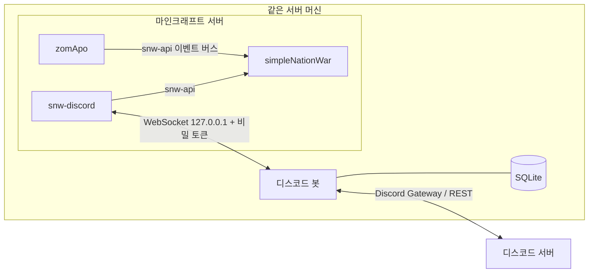

# 디스코드 연동

## 1. 구성

| 구성 요소 | 형태 | 브랜치 (예정) | 맡는 일 |
|---|---|---|---|
| **디스코드 봇** | 독립 Kotlin 프로세스 | `discord-bot` | 가입·닉네임 등록, 마크 계정 연동 확인, 상호평가, 팀 편성, 국가 역할·채널 생성, 알림·상태 채널 |
| **snw-discord** | Fabric 서버 모드 | `discord-mod` | 봇과 통신, 연동 안 된 계정 접속 차단, 닉네임·소속 반영, 게임 이벤트 송신, 인게임 상호평가 폼(선택) |

## 2. 왜 봇을 따로 띄우나

- **마크 서버가 꺼져 있어도 봇은 돌아야 한다.** 가입·닉네임 등록·상호평가·팀 편성은 개장 전에, 서버가 없는 시간에 일어난다.
- 마크 서버를 재시작해도 디스코드 연결이 끊기지 않는다.
- 봇 라이브러리(JDA 등)와 그 의존성을 마크 서버 클래스패스에 넣지 않는다.

## 3. 데이터의 주인

| 데이터 | 원본 | 사본 |
|---|---|---|
| 디스코드 ID ↔ 마크 UUID 연동, 커스텀 닉네임, 접속 가능 시간 | 봇 DB | 모드 캐시(`config/snw-discord/cache.json`), `snw_players` 닉네임 캐시 |
| 상호평가 원자료·집계 | 봇 DB | 없음(모드는 결과를 모름) |
| 국가 소속 확정 | 봇 DB(편성 결과) → 모드로 내려보냄 | `snw_nations` (이후 게임 안의 원본) |
| K/D/A, 좀비 통계, 영토, 감염 레벨 | 마크 서버 `SavedData` | 봇은 이벤트·스냅샷만 받아 표시 |
| 접속 세션 기록 | 봇 DB (모드가 보냄) | 시뮬레이션 보정, 이벤트 시간 조정용 |

## 4. 장애 시 동작

| 상황 | 동작 |
|---|---|
| 봇이 꺼짐 | 모드는 캐시로 접속 확인·닉네임 표시를 계속한다. 연동 안 된 새 계정은 "봇 점검 중" 안내와 함께 거부. 보낼 이벤트 중 중요한 것(킬·백신 조각·거점 점령)만 디스크 대기열에 쌓았다가 재연결 시 보낸다 |
| 마크 서버가 꺼짐 | 봇은 가입·평가·편성을 그대로 처리. 상태 채널에 "서버 꺼짐" |
| 네트워크 순단 | 모드가 지수 백오프로 재연결(1초 → 최대 60초). 재연결하면 `hello` → 봇이 전체 동기화(`welcome`) |

## 5. 문서

- [bot.md](bot.md): 봇 기능, 채널·역할 구조, 가입 흐름, 기술 스택
- [mod.md](mod.md): 연동 모드
- [protocol.md](protocol.md): 통신 규약
- [peer-rating.md](peer-rating.md): 상호평가와 균형 팀 편성
