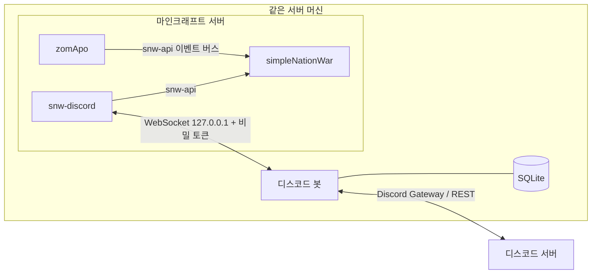

# 디스코드 연동

구조·봇·연동 모드. 통신 규약은 [protocol.md](protocol.md), 상호평가와 국가 추첨식은 [peer-rating.md](peer-rating.md), 생존일지는 [diary.md](diary.md).

## 목차

1. [구조](#구조)
2. [디스코드 봇](#디스코드-봇)
3. [연동 모드](#연동-모드)


---

## 구조

### 1. 구성

| 구성 요소 | 형태 | 브랜치 (예정) | 맡는 일 |
|---|---|---|---|
| **디스코드 봇** | 독립 Kotlin 프로세스 | `discord-bot` | 가입·닉네임 등록, 마크 계정 연동 확인, 상호평가, 팀 편성, 국가 역할·채널 생성, 알림·상태 채널 |
| **snw-discord** | Fabric 서버 모드 | `discord-mod` | 봇과 통신, 연동 안 된 계정 접속 차단, 닉네임·소속 반영, 게임 이벤트 송신, 인게임 상호평가 폼(선택) |



### 2. 왜 봇을 따로 띄우나

- **마크 서버가 꺼져 있어도 봇은 돌아야 한다.** 가입·닉네임 등록·상호평가·팀 편성은 개장 전에, 서버가 없는 시간에 일어난다.
- 마크 서버를 재시작해도 디스코드 연결이 끊기지 않는다.
- 봇 라이브러리(JDA 등)와 그 의존성을 마크 서버 클래스패스에 넣지 않는다.

### 3. 데이터의 주인

| 데이터 | 원본 | 사본 |
|---|---|---|
| 디스코드 ID ↔ 마크 UUID 연동, 커스텀 닉네임, 접속 가능 시간 | 봇 DB | 모드 캐시(`config/snw-discord/cache.json`), `snw_players` 닉네임 캐시 |
| 상호평가 원자료·집계 | 봇 DB | 없음(모드는 결과를 모름) |
| 국가 소속 확정 | 봇 DB(편성 결과) → 모드로 내려보냄 | `snw_nations` (이후 게임 안의 원본) |
| K/D/A, 좀비 통계, 영토, 감염 레벨 | 마크 서버 `SavedData` | 봇은 이벤트·스냅샷만 받아 표시 |
| 접속 세션 기록 | 봇 DB (모드가 보냄) | 시뮬레이션 보정, 이벤트 시간 조정용 |

### 4. 장애 시 동작

| 상황 | 동작 |
|---|---|
| 봇이 꺼짐 | 모드는 캐시로 접속 확인·닉네임 표시를 계속한다. 연동 안 된 새 계정은 "봇 점검 중" 안내와 함께 거부. 보낼 이벤트 중 중요한 것(킬·백신 조각·거점 점령)만 디스크 대기열에 쌓았다가 재연결 시 보낸다 |
| 마크 서버가 꺼짐 | 봇은 가입·평가·편성을 그대로 처리. 상태 채널에 "서버 꺼짐" |
| 네트워크 순단 | 모드가 지수 백오프로 재연결(1초 → 최대 60초). 재연결하면 `hello` → 봇이 전체 동기화(`welcome`) |

### 5. 문서

- [README.md](#디스코드-봇): 봇 기능, 채널·역할 구조, 가입 흐름, 기술 스택
- [README.md](#연동-모드): 연동 모드
- [protocol.md](protocol.md): 통신 규약
- [peer-rating.md](peer-rating.md): 상호평가와 국가 추첨식(팀 편성)


---

## 디스코드 봇

### 1. 기술 스택

| 항목 | 선택 | 이유 |
|---|---|---|
| 언어 | Kotlin 2.4 (JVM 25) | 요구 사항, 모드와 같은 언어 |
| 디스코드 라이브러리 | **JDA 6.x** + jda-ktx | 가장 성숙한 JVM 라이브러리. 6.4 에서 모달 안의 체크박스·라디오 그룹을 지원해 상호평가 폼을 모달 하나로 만들 수 있다. jda-ktx 로 코루틴·DSL 사용 |
| 모드와의 통신 | Ktor 서버 (WebSocket) | 봇이 서버, 모드가 클라이언트 |
| DB | SQLite + Exposed | 15명 규모에 충분, 파일 하나로 백업 |
| 직렬화 | kotlinx.serialization | 모드와 메시지 모델 공유 |
| 실행 | systemd 서비스 또는 Docker, 마크 서버와 같은 머신 | |

대안인 Kord(순수 Kotlin)는 API 가 깔끔하지만 새 디스코드 기능(모달 컴포넌트 등) 지원이 JDA 보다 늦는 편이라 JDA 를 고른다.

#### 디스코드 개발자 포털 설정

- **Server Members Intent**(특권 인텐트) 켜기: 새 멤버 입장 이벤트와 역할 관리에 필요.
- Message Content Intent 는 쓰지 않는다. 입력은 모두 버튼·모달·슬래시 명령으로 받는다.
- 봇 권한: 역할 관리, 채널 관리, 별명 관리, 메시지 보내기, 임베드, 멤버 보기.
- 토큰은 환경 변수로만 넣는다. 저장소에 두지 않는다.

### 2. 채널과 역할

#### 역할

| 역할 | 색 | 부여 시점 |
|---|---|---|
| 미등록 | 기본 | 서버 입장 즉시 |
| 생존자 | 기본 | 닉네임 등록 + 마크 계정 연동 완료 |
| 1국 / 2국 / 3국 | `#FF0045` / `#3355BB` / `#FFCC11` | 팀 확정 시 |
| 원수 | 기본 | 국가 투표 후 |
| 운영진 | 기본 | 수동 |

#### 채널

| 채널 | 보이는 역할 | 용도 |
|---|---|---|
| #등록 | 미등록 | 가입 안내 임베드 + [등록하기] [연동 코드 입력] 버튼 |
| #공지, #규칙 | 생존자 | |
| #서버-상태 | 생존자 | 매일 06:05 상태 임베드, 서버 켜짐/꺼짐 |
| #오늘의-서버-기록 | 생존자 | 매일 아침 '오늘의 서버 기록'([diary.md](diary.md)) |
| #알림 | 생존자 | 킬 피드, 망자, 거점전, 블러드문(10분 전 예고), 둥지, 백신 조각, 10성 강화 |
| #자유, 🔊자유 | 생존자 | |
| **국가 카테고리 ×3** (팀 확정 후 자동 생성) | 해당 국가 역할 | #국가-채팅, #국가-알림(망자 좌표 등), 🔊국가-음성 |

미등록 역할은 #등록 외에는 아무것도 볼 수 없다. **디스코드에 들어오면 닉네임을 적지 않고는 다른 채널을 볼 수 없게** 해서 "무조건 적도록"을 강제한다.

### 3. 가입 흐름

1. 입장 → `미등록` 역할, 환영 DM.
2. #등록 의 **[등록하기]** → 모달
   - 마크 이름 (Java 계정 이름)
   - 커스텀 닉네임 ([nickname.md](../design/nickname.md) 규칙)
   - 주로 접속할 시간대 (체크박스: 평일 저녁 / 평일 밤 / 평일 새벽 / 주말 낮 / 주말 저녁 / 주말 밤)
   - 동의 (체크박스): [필수] 닉네임에 실명·학교·나이·연락처·사는 곳을 넣지 않았다 / 생존일지에 닉네임 표시(기본 켬) / 웃긴 기록에 나와도 좋다(기본 끔)
   - 일주일 예상 플레이 시간 (라디오: ~3h / 3~7h / 7~14h / 14h~)
3. 봇이 검사: 닉네임 형식·중복·**개인정보**([nickname.md](../design/nickname.md) 3절), 마크 이름 존재 여부와 UUID(모장 프로필 조회). '운영자 확인' 판정이면 운영진 채널에 이유와 함께 올리고 승인을 기다린다.
4. "마크 서버에 접속하면 6자리 코드가 뜹니다" 안내.
5. 마크 서버 접속 시도 → 연동 모드가 접속을 거부하며 코드를 보여 준다(코드는 10분 유효).
6. #등록 의 **[연동 코드 입력]** → 모달에 코드 입력 → 봇이 UUID 일치 확인.
7. 완료: `생존자` 역할, 디스코드 별명 `닉네임`(마크 이름은 디스코드에 드러내지 않는다), 모드로 `link.confirmed` 전송. 다시 접속하면 입장.

접속 가능 시간대와 예상 플레이 시간은 국가 추첨식의 참여도와 이벤트 시간 결정에 쓴다. 가입이 끝나면 #등록 의 **[단짝 지목]** 버튼(유저 선택 메뉴)으로 같이 하고 싶은 한 명을 고를 수 있다. 서로 지목했을 때만 같은 국가로 묶이고, 누가 누구를 골랐는지는 공개하지 않는다.

### 4. 명령

| 명령 | 대상 | 하는 일 |
|---|---|---|
| `/정보 [유저]` | 모두 | 인게임 `/info` 카드와 같은 임베드 (서버가 꺼져 있으면 마지막 스냅샷) |
| `/닉네임 변경` | 모두 | 모달로 새 닉네임 신청 → 운영진 승인 버튼 → 반영 |
| `/평가 시작 [마감] [항목]` | 관리자 | 상호평가 라운드 시작 ([peer-rating.md](peer-rating.md)) |
| `/평가 현황` | 관리자 | 누가 몇 명 평가했는지 (점수는 안 보임) |
| `/평가 종료` | 관리자 | 마감, 집계 |
| `/평가 결과 [공개]` | 관리자 | 본인에게 DM 발송, `공개` 옵션이면 #공지에 요약 |
| `/팀 팀장 <3명>` | 관리자 | 팀장(원수) 확정 |
| `/팀 추첨` | 관리자 | 국가 추첨식: 시드 해시 공개 → 한 명씩 공개 → 시드 공개 ([peer-rating.md](peer-rating.md) 5절) |
| `/팀 교환` | 모두 (교환 창 동안) | 다른 국가 한 명과 맞교환 신청. 양쪽이 신청하고 균형 기준을 지키면 성사 |
| `/팀 확정` | 관리자 | 국가 역할 부여, 국가 카테고리·채널 생성, 모드로 `nation.assign` |
| `/팀 최적화` | 관리자 (예비) | 최적화 편성 상위 3안 |
| `/서버 상태` | 관리자 | 접속자, TPS, 봇 연결 |
| `/서버 공지 <내용>` | 관리자 | 디스코드 #공지 + 인게임 방송 |

### 5. 알림과 상태

#### #알림 (예)

| 사건 | 메시지 |
|---|---|
| PvP 킬 | `⚔ 철수 → 영희 (어시스트: 민수)` |
| 망자 | `🧟 영희 님이 망자가 되었습니다` (좌표는 국가 채널에만) |
| 거점전 | `🏴 접경 거점(1국-2국)을 2국이 점령했습니다` |
| 블러드문 | 시작, 결과(습격 지점, 막은 웨이브 수 0~3, 참가자 닉네임). 예: `🩸 블러드문 끝 — 생존자 캠프를 지켜 냈습니다 (웨이브 3/3, 참가 6명)` |
| 둥지 | 발견, 파괴(참여자) |
| 백신 조각 | `🧪 백신 조각을 누군가 주웠습니다 (서버 전체 4개)` |
| 강화 | `★ 철수 님이 다이아몬드 검 10성 강화를 달성했습니다` |
| 블러드문 예고 | `@생존자 🌕 블러드문이 10분 뒤 시작됩니다 — 습격 지점: 2국 수도` |

임베드 테두리 색은 국가 색 또는 [nation.md](../design/nation.md#화면) 의 의미 색을 쓴다.

#### #서버-상태 (매일 06:05)

- 어제 접속자 수·총 플레이 시간
- 국가별 영토 감염 레벨, 전역 램프, 서버 감염도
- 거점 소유 현황, 연구 진행도
- 이번 주 좀비 스코어 상위 3명

### 6. DB 스키마

| 테이블 | 주요 열 |
|---|---|
| `users` | discord_id, mc_uuid, mc_name, nickname, nickname_changed_at, availability(JSON), weekly_hours_band, buddy_id, nation_leader_wish, registered_at, linked_at |
| `link_codes` | code, mc_uuid, mc_name, expires_at |
| `nicknames_pending` | discord_id, requested, requested_at, status |
| `rating_rounds` | id, status, categories(JSON), started_at, deadline |
| `ratings` | round_id, rater_id, target_id, category, stars(1~5 또는 NULL=모름), updated_at |
| `team_draws` | id, round_id, seed_hash, seed, leaders(JSON), result(JSON), metrics(JSON), tries, swaps(JSON), confirmed |
| `nations` | id, name, color, role_id, category_id, channel_ids(JSON), leader_id |
| `activity_hourly` | date, hour, online_count — 시간대별 접속자 수 집계만. 개인별 접속·퇴장 시각은 저장하지 않는다 |
| `diary_memory` | day_number, memory(JSON) — 생존일지 기억(내부 키·문장 틀 사용일만, 닉네임 없음) |
| `events` | id, type, payload(JSON), ts |
| `snapshots` | date, payload(JSON) |

### 7. 설정

```
SNW_BOT_TOKEN       (환경 변수) 디스코드 봇 토큰
SNW_WS_SECRET       (환경 변수) 모드 연결용 비밀 토큰
config.json         guildId, 채널·역할 id, wsHost(127.0.0.1), wsPort, 평가 기본 항목, 알림 on/off
```

### 8. 운영 메모

- DB 파일은 마크 월드와 같은 백업 주기(매일)로 백업한다.
- 접속 기록은 처음부터 시간대별 접속자 수로만 모은다(블러드문 조건 판정·이벤트 시간 조정에 충분하다).
- 시즌이 끝나면 접속 가능 시간대와 상호평가 원자료를 지우고 집계만 남긴다. 전체 정책은 zomApo [privacy.md](https://github.com/menonng/zomApo/blob/HEAD/docs/server/privacy.md).


---

## 연동 모드

Fabric 서버 모드, Kotlin, `environment: "server"`. 브랜치 `discord-mod` 에서 개발한다(코드 단계에서 생성).

의존: Fabric API, FLK, **simpleNationWar(`snw-api`)**. 추가 라이브러리는 넣지 않는다. WebSocket 은 JDK 내장 `java.net.http.WebSocket` 을 쓴다.

### 1. 하는 일

| 기능 | 설명 |
|---|---|
| 봇 연결 | `ws://127.0.0.1:<port>/snw` 에 비밀 토큰으로 접속. 끊기면 지수 백오프로 재연결 |
| **접속 확인** | 로그인 단계에서 UUID 가 연동 목록에 없으면 접속을 거부하고 6자리 코드를 보여 준다 |
| 닉네임 반영 | `link.confirmed`, `nickname.updated` 를 받아 `snw-api` 로 닉네임 설정 |
| 소속 반영 | `nation.assign` 을 받아 `snw-api` 로 국가·원수 설정 |
| 이벤트 송신 | `snw-api` 이벤트(킬, 영토, 관계, 거점, 연구)와 이벤트 버스로 들어온 zomApo 이벤트(블러드문, 둥지, 감염 레벨, 망자, 강화)를 봇으로 전달 |
| 세션 기록 | 접속·퇴장 시각 송신 |
| 인게임 상호평가 (선택) | `rating.request` 를 받으면 접속 중인 대상자에게 **상자창**(대상마다 한 줄, 별 1~5·모름 칸을 눌러 고름)으로 평가 폼을 띄우고 `rating.submit` 으로 돌려보낸다 |
| 공지 방송 | `announce` 를 받아 전체 채팅 + 타이틀 |

**채팅은 중계하지 않는다.** couriersRoost 의 전서구 지연을 살리기 위해서다. 필요해지면 설정으로 '전체 채팅만, 전서구 도착 시점에' 중계하는 옵션을 둔다.

### 2. 접속 확인

```
로그인 요청 (UUID, 이름)
 ├─ 연동 목록(캐시)에 있음 → 통과
 └─ 없음
     ├─ 봇 연결됨 → 코드 발급(10분), link.code 송신, 거부 화면:
     │     "디스코드 #등록 에서 [연동 코드 입력] 을 누르고 코드 482913 을 입력하세요"
     └─ 봇 연결 안 됨 → 거부 화면: "디스코드 봇 점검 중입니다. 잠시 후 다시 시도하세요"
```

- 바닐라 화이트리스트는 끄고 이 확인을 화이트리스트로 쓴다. 운영자는 `/snwd` 로 예외 UUID 를 둘 수 있다.
- 거부 화면 문구의 코드는 강조색(하늘 `#39C5BB`)으로 표시한다.
- 같은 UUID 로 10분 안에 다시 시도하면 같은 코드를 보여 준다.

### 3. 캐시

`config/snw-discord/cache.json`: 연동 목록(UUID ↔ 디스코드 ID), 닉네임, 국가 배정. 봇이 `welcome` 을 보낼 때마다 통째로 갱신한다. 봇이 꺼져 있어도 이 캐시로 기존 플레이어는 접속하고 닉네임도 보인다.

### 4. 대기열

봇과 연결이 끊긴 동안 생긴 이벤트 중 **잃으면 안 되는 것**(킬, 백신 조각, 거점 점령)만 `config/snw-discord/outbox.jsonl` 에 쌓았다가 재연결 후 보낸다. 나머지(접속 알림 등)는 버린다. 메시지마다 고유 id 가 있어 봇이 중복을 걸러 낸다.

### 5. 설정

`config/snw-discord.json`

```json
{
  "botUrl": "ws://127.0.0.1:7341/snw",
  "secretEnv": "SNW_WS_SECRET",
  "gateEnabled": true,
  "gateBypass": [],
  "relayChat": false,
  "inGameRating": true,
  "outboxTypes": ["player.death", "vaccine.shard", "landmark.captured"]
}
```

비밀 토큰은 설정 파일이 아니라 환경 변수에서 읽는다.

### 6. 명령

`/snwd status`, `/snwd reload`, `/snwd resync` (운영자). 일반 플레이어 명령 없음.


---

## 구현 (2026-11-23)

| 부분 | 위치 | 상태 |
|---|---|---|
| 공용 규약 | `logic` 의 `discord/`(메시지 종류·ack·대기열 종류·ULID·중복 거르기·재연결 간격·연동 코드·사건 매핑·#알림 문장) | 테스트 `DiscordProtocolTest` |
| 연동 모드 | 별도 모드 대신 **snw 안의 `discord/DiscordLink.kt`**(기본 꺼짐, `config/snw-discord.json` 의 `enabled`). 접속 확인은 `PlayerListLoginMixin`(바닐라 화이트리스트 자리) | 실제 봇에 붙여 연결·사건 전달 확인 |
| 봇 | `discord-bot` 모듈(JDA 6.4.1, Java-WebSocket 1.6.0, SQLite). `ModHub`(규약·가입·연동 규칙, 디스코드와 분리), `WsServer`, `DiscordFront`(JDA), `DiaryJob`(일지 모듈), `Db` | 통합 테스트 `BotFlowTest`(실제 WebSocket: 비밀 불일치 거부, hello→welcome, 연동 코드→연동→link.confirmed·ack, 중복 사건 한 번만, 일지에 마크 이름 없음) |

- 설계의 Ktor 대신 Java-WebSocket(가벼움), Exposed 대신 JDBC 로 했다.
- 등록 모달은 텍스트 칸만 쓴다(마크 이름·닉네임·시간대·주간 시간·'동의'). 일지 닉네임 표시는 기본 켬, 웃긴 기록은 기본 끔.
- 실행: `./gradlew :discord-bot:installDist` → `SNW_BOT_TOKEN=… SNW_WS_SECRET=… discord-bot/build/install/discord-bot/bin/discord-bot config.json`. 토큰이 없으면 디스코드 없이 모드 연결·기록만 한다(시험용).
- **아직 안 한 것**: 상호평가·국가 추첨식(`/평가`·`/팀`, peer-rating.md), 닉네임 변경 승인 버튼(지금은 운영진 채널 알림 + 보관), 국가 카테고리·채널 자동 생성, 게임 안 평가 창(상자창). 실제 디스코드 서버에서의 동작은 토큰이 없어 확인하지 못했다.
