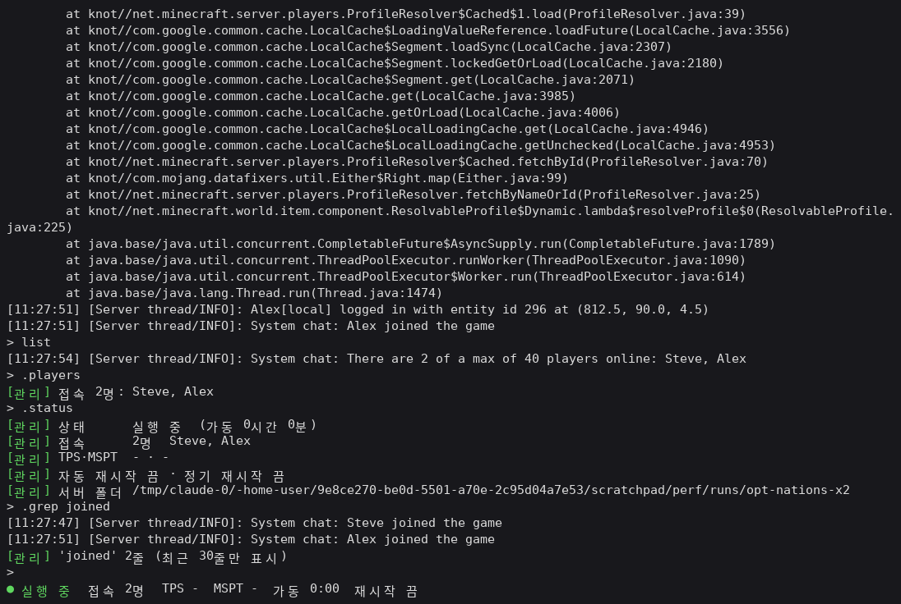

# 서버 관리 프로그램 (snw-panel)

`server-panel` 브랜치. Fabric 서버를 감싸서 **Paper 콘솔처럼** 쓰는 CLI 다. 서버 로그는 위로 흐르고(수준별 색), 맨 아래에 입력 줄과 상태 줄이 붙어 있다. 거기에 재시작·백업·예약 재시작·크래시 복구·시즌 명령 같은 편의 기능을 얹었다. 창 버전도 `--gui` 로 남겨 두었다.



## CLI 쓰는 법

```
./gradlew :panel:fatJar          → panel/build/libs/snw-panel.jar
```

1. `snw-panel.jar`, `snw-panel.bat` 을 같은 폴더에 둔다. `snw-panel.bat` 을 더블클릭하면 명령 프롬프트(또는 Windows 터미널)에 열린다.
2. 처음이면 `panel.properties` 가 생긴다. `.config dir D:\mc\server` 로 서버 폴더를 정한다.
3. `.start`. 이후 서버 명령은 그냥 친다(`list`, `say 안녕`, `snw season status` …). 앞의 `/` 는 없어도 된다.

| 입력 | 하는 일 |
|---|---|
| 그냥 치는 줄 | 서버 명령 |
| Tab | 자동완성: 첫 낱말은 서버 명령(켜질 때 `help` 로 모은 실제 목록) + 관리 명령, 그 뒤는 접속자 이름·하위 명령(`snw season` 등) |
| ↑ ↓, Ctrl+R | 명령 기록(파일로 남아 다음 실행에도 이어짐), 기록 검색 |
| Ctrl+C 두 번 | 서버를 끄고 나가기 |

**관리 명령** (점으로 시작)

| 명령 | 하는 일 |
|---|---|
| `.start` / `.stop` / `.restart [이유]` / `.kill` | 켜기 / 저장하고 끄기 / 재시작(직전 자동 백업) / 강제 종료(확인 후) |
| `.status` | 상태·가동 시간·접속자·TPS·MSPT·자동 재시작·정기 재시작·서버 폴더 |
| `.players` | 접속자 목록 |
| `.backup` | 월드 zip 백업(켜져 있으면 save-off → flush → 압축 → save-on), 최근 7개 보관 |
| `.schedule 06:00` / `.schedule off` | 매일 정기 재시작(10·5·1분 전 게임 안 경고) |
| `.autorestart on|off` | 비정상 종료 시 10초 뒤 자동 재시작 |
| `.grep <글자>` | 최근 로그 5,000줄에서 찾기 |
| `.season start` / `.season status` | 시즌 시작(확인 후) / 상태 |
| `.config` / `.config dir <폴더>` | 설정 보기 / 서버 폴더 바꾸기 |
| `.clear`, `.help`, `.exit` | 화면 지우기, 도움말, 서버를 끄고 나가기 |

상태 줄(맨 아래): `● 실행 중  접속 2명  TPS 19.8  MSPT 12.3  가동 1:05  재시작 06:00`. TPS·MSPT 는 1분마다 spark 로 조용히 조회한다(출력은 숨김).

색: 경고 노랑, 오류 빨강, 채팅 하늘색, 관리 메시지 머리 `[관리]` 초록. 나머지는 터미널 기본색.

창 버전: `snw-panel-gui.bat` (또는 `java -jar snw-panel.jar --gui`). 기능은 같은 축(켜기·끄기·재시작·백업·접속자·TPS)이고, CLI 가 기본이다.

## 왜 만들었나

| 비교 | 바닐라·Fabric 기본 | Paper | snw-panel |
|---|---|---|---|
| 콘솔 색·자동완성 | 없음 (Better Fabric Console 모드로 해결) | 있음 | 있음(오류 빨강·경고 노랑·채팅 하늘) |
| 접속자 목록 | 바닐라 서버 GUI 에 있음 | 같음 | 있음 |
| TPS·MSPT | spark 명령 | `/tps` | 1분마다 자동 표시(spark) |
| 재시작·크래시 복구 | 없음(스크립트 필요) | 없음(스크립트 필요) | 정기 재시작(경고 10·5·1분 전), 비정상 종료 시 자동 재시작 |
| 백업 | 없음 | 없음 | 버튼 하나, 정기 재시작 때 자동, 최근 7개 보관 |
| 시즌 명령 | — | — | 시즌 시작·상태 버튼 |

Paper 도 '관리 창'이 따로 있는 것은 아니다(바닐라 서버 GUI 를 같이 쓴다). Paper 가 나은 점은 콘솔인데, 그건 Better Fabric Console 모드로 메운다. 이 창은 그 위에 재시작·백업·시즌 버튼을 더한다.

**bash 스크립트 대신 Kotlin CLI 로 한 이유**: 서버 PC 가 Windows 라 bash 가 기본으로 없다. Java 는 서버 때문에 이미 깔려 있으므로, 같은 jar 하나로 Windows·리눅스 어디서나 Paper 콘솔과 같은 입력 줄(JLine)을 쓸 수 있다.

## 쓰는 법

```
./gradlew :panel:fatJar          → panel/build/libs/snw-panel.jar (의존성 포함 하나)
```

1. `snw-panel.jar` 와 `snw-panel.bat` 을 아무 폴더에 둔다.
2. `snw-panel.bat` 을 더블클릭(또는 `java -jar snw-panel.jar`). 처음이면 `panel.properties` 가 생긴다.
3. **설정 폴더** 버튼으로 서버 폴더(`fabric-server-launch.jar` 가 있는 곳)를 고른다.
4. **시작**.

| 설정 (`panel.properties`) | 기본값 | 뜻 |
|---|---|---|
| `server.dir` | `.` | 서버 폴더 |
| `java` | `java` | Java 25 실행 파일 |
| `jar` | `fabric-server-launch.jar` | 서버 jar |
| `heap` | `8G` | `-Xms`·`-Xmx` ([performance.md](https://github.com/menonng/zomApo/blob/HEAD/docs/server/performance.md) 9절) |
| `jvm.extra` | G1 세트 + GC 스레드 4/2 | 같은 PC 에서 게임할 때 클라이언트 프레임을 덜 뺏게 |
| `restart.auto` | `true` | 비정상 종료 시 10초 뒤 다시 켬 |
| `restart.daily` | `06:00` | 정기 재시작(감염 레벨 재계산 시각과 맞춤). `off` 로 끔 |
| `backup.dir` / `backup.keep` | `backups` / `7` | 백업 폴더와 보관 개수 |

명령 입력: 앞의 `/` 는 없어도 된다. 위·아래 화살표로 기록, Tab 으로 명령·접속자 이름 자동완성. 서버가 완전히 켜지기 전(`Done` 전)에는 명령을 받지 않는다.

## 구조

| 파일 | 내용 |
|---|---|
| `panel/.../Core.kt` | 화면과 무관한 부분: 설정, 콘솔 줄 해석(접속·퇴장·준비·TPS·MSPT, 26.x 의 `System chat:` 형식 포함), 명령 기록, 자동완성, 재시작 일정, 백업 보관. 단위 테스트 5개 |
| `panel/.../Supervisor.kt` | 서버 돌보기: 켜기·끄기·재시작, 크래시 자동 재시작, 정기 재시작·경고, 재시작 전 백업, TPS·MSPT 조회, 서버 명령 목록 수집 |
| `panel/.../Cli.kt` | JLine 콘솔: 입력 줄 위로 로그 끼워 넣기, 상태 줄, 자동완성, 명령 기록, 관리 명령 |
| `panel/.../Main.kt` | 시작점(기본 CLI, `--gui` 면 Swing + FlatLaf 창) |

시험: 가상 터미널에서 CLI 를 띄워 실제 26.3 Fabric 서버를 시작 → Carpet 봇 2명 접속 → `list`·`.players`·`.status`·`.grep`·Tab 자동완성(`snw sea` → `snw season`)·상태 줄·`.exit`(서버 정상 종료)까지 확인했다(위 화면. 위쪽의 긴 오류는 시험 환경에서 봇 프로필 조회가 막혀서 난 것). 창 버전도 같은 서버로 확인했다.

## 다음에 더할 것 (필요하면)

- 국가별 접속자 색(snw-api 를 읽는 작은 로컬 연결)
- 디스코드 봇 프로세스도 같은 창에서 켜고 끄기
- 리소스팩 다시 만들기 버튼(tools/respack)
- 그래프(MSPT·접속자 시간대별)
