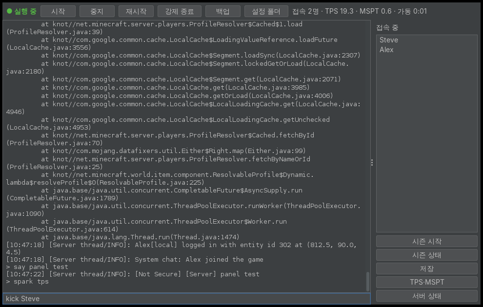

# 서버 관리 창 (snw-panel)

`server-panel` 브랜치. Fabric 서버를 켜고 끄고, 콘솔을 보고, 명령을 넣고, 백업·정기 재시작을 하는 데스크톱 창이다. 서버를 돌리는 PC(Windows 11)에서 운영자가 같이 플레이하는 상황에 맞췄다.



## 왜 만들었나

| 비교 | 바닐라·Fabric 기본 | Paper | snw-panel |
|---|---|---|---|
| 콘솔 색·자동완성 | 없음 (Better Fabric Console 모드로 해결) | 있음 | 있음(오류 빨강·경고 노랑·채팅 하늘) |
| 접속자 목록 | 바닐라 서버 GUI 에 있음 | 같음 | 있음 |
| TPS·MSPT | spark 명령 | `/tps` | 1분마다 자동 표시(spark) |
| 재시작·크래시 복구 | 없음(스크립트 필요) | 없음(스크립트 필요) | 정기 재시작(경고 10·5·1분 전), 비정상 종료 시 자동 재시작 |
| 백업 | 없음 | 없음 | 버튼 하나, 정기 재시작 때 자동, 최근 7개 보관 |
| 시즌 명령 | — | — | 시즌 시작·상태 버튼 |

Paper 도 '관리 창'이 따로 있는 것은 아니다(바닐라 서버 GUI 를 같이 쓴다). Paper 가 나은 점은 콘솔인데, 그건 Better Fabric Console 모드로 메운다. 이 창은 그 위에 재시작·백업·시즌 버튼을 더한다.

**CLI(bash) 대신 창으로 한 이유**: 서버 PC 가 Windows 라 bash 가 기본으로 없고, 운영자가 같은 PC 에서 게임을 하므로 창을 띄워 두고 보는 쪽이 편하다. 자동화가 필요하면 같은 기능을 명령줄로도 쓸 수 있게 나중에 `--autostart` 처럼 옵션을 늘린다.

## 쓰는 법

```
./gradlew :panel:fatJar          → panel/build/libs/snw-panel.jar (의존성 포함 하나)
```

1. `snw-panel.jar` 와 `snw-panel.bat` 을 아무 폴더에 둔다.
2. `snw-panel.bat` 을 더블클릭(또는 `java -jar snw-panel.jar`). 처음이면 `panel.properties` 가 생긴다.
3. **설정 폴더** 버튼으로 서버 폴더(`fabric-server-launch.jar` 가 있는 곳)를 고른다.
4. **시작**.

| 설정 (`panel.properties`) | 기본값 | 뜻 |
|---|---|---|
| `server.dir` | `.` | 서버 폴더 |
| `java` | `java` | Java 25 실행 파일 |
| `jar` | `fabric-server-launch.jar` | 서버 jar |
| `heap` | `8G` | `-Xms`·`-Xmx` ([performance.md](https://github.com/menonng/zomApo/blob/HEAD/docs/server/performance.md) 9절) |
| `jvm.extra` | G1 세트 + GC 스레드 4/2 | 같은 PC 에서 게임할 때 클라이언트 프레임을 덜 뺏게 |
| `restart.auto` | `true` | 비정상 종료 시 10초 뒤 다시 켬 |
| `restart.daily` | `06:00` | 정기 재시작(감염 레벨 재계산 시각과 맞춤). `off` 로 끔 |
| `backup.dir` / `backup.keep` | `backups` / `7` | 백업 폴더와 보관 개수 |

명령 입력: 앞의 `/` 는 없어도 된다. 위·아래 화살표로 기록, Tab 으로 명령·접속자 이름 자동완성. 서버가 완전히 켜지기 전(`Done` 전)에는 명령을 받지 않는다.

## 구조

| 파일 | 내용 |
|---|---|
| `panel/.../Core.kt` | 화면과 무관한 부분: 설정, 콘솔 줄 해석(접속·퇴장·준비·TPS·MSPT, 26.x 의 `System chat:` 형식 포함), 명령 기록, 자동완성, 재시작 일정, 백업 보관. 단위 테스트 5개 |
| `panel/.../Main.kt` | Swing + FlatLaf 창, 서버 프로세스(표준 입출력으로 연결), 백업(zip, 켜져 있으면 save-off → save-all flush → 압축 → save-on) |

시험: 실제 26.3 Fabric 서버 폴더로 창을 띄워 시작 → Carpet 봇 2명 접속 → 접속자 목록·TPS·MSPT·자동완성이 갱신되는 것을 확인했다(위 화면).

## 다음에 더할 것 (필요하면)

- 국가별 접속자 색(snw-api 를 읽는 작은 로컬 연결)
- 디스코드 봇 프로세스도 같은 창에서 켜고 끄기
- 리소스팩 다시 만들기 버튼(tools/respack)
- 그래프(MSPT·접속자 시간대별)
